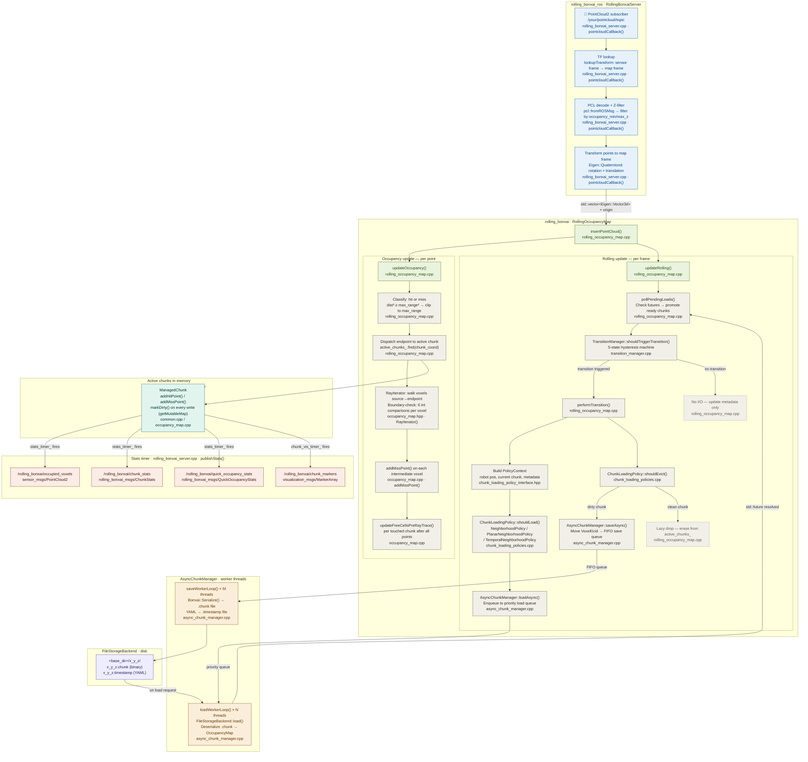

# Rolling Bonxai Architecture

How Rolling Bonxai is built: the packages, the rolling engine's subsystems, and the path a point cloud takes from the sensor to disk. See [README.md](README.md) for an overview and [USAGE.md](USAGE.md) for building and running it.

## Contents

1. [Architecture Overview](#architecture-overview)
2. [Data Flow Diagram](#data-flow-diagram)
3. [Known Limitations](#known-limitations)

---

## Architecture Overview

Rolling Bonxai is organized into a layered package hierarchy. `bonxai_core` (external, by Davide Faconti) provides the fundamental sparse voxel grid data structure — refer to the [Bonxai repository](https://github.com/facontidavide/Bonxai) for its internals. The packages described here build on top of it.

### `bonxai_map` — Probabilistic Occupancy Map

`bonxai_map` wraps a `Bonxai::VoxelGrid<CellOcc>` to implement a **probabilistic 3D occupancy map** using log-odds representation. Each voxel stores an integer log-odds value (scaled by 1×10⁶ for fixed-point arithmetic) and an `update_id` that prevents multiple updates to the same cell within a single sensor sweep. The `OccupancyMap` class exposes `insertPointCloud()` as the primary update interface: for each incoming point it classifies the endpoint as a hit or miss (based on `max_range`), records the endpoint in a staging buffer, then calls `updateFreeCells()` to ray-trace from the sensor origin through all buffered endpoints, marking intermediate voxels as free. An `Accessor` cache is maintained internally to amortize lookup costs across bulk insertions. The class is move-only; copying is disabled because of its potentially large memory footprint.

### `rolling_bonxai` — The Rolling Engine

`rolling_bonxai` implements the chunking and rolling-window logic. It is composed of six collaborating subsystems:

**`ChunkCoordinateSystem`** defines a center-origin spatial grid where chunk (0,0,0) is centered at world-origin (0,0,0). It converts between world positions (meters), voxel coordinates (`Bonxai::CoordT`), and chunk coordinates (`ChunkCoord`), and provides neighbor enumeration and boundary-distance queries used by the other subsystems.

**`TransitionManager`** runs a 5-state machine (UNINITIALIZED → STABLE_SOURCE → HYSTERESIS_SOURCE → HYSTERESIS_NEXT → STABLE_NEXT) that prevents thrashing at chunk boundaries. A chunk transition is only confirmed — and a load/evict cycle only triggered — when the robot has penetrated `hysteresis_ratio × chunk_size` meters into the geometrically new chunk. Large position jumps (>1 chunk) bypass hysteresis to handle localization resets.

**`ChunkLoadingPolicy`** is a pure-virtual interface with three built-in implementations: `NeighborhoodPolicy` (3D Chebyshev ball), `PlanarNeighborhoodPolicy` (horizontal ball + vertical Z range, for ground robots), and `TemporalNeighborhoodPolicy` (neighborhood filtered by chunk age). Policies answer two questions per candidate chunk: *should it be loaded?* and *what priority should it have in the load queue?*

**`ManagedChunk`** owns a `unique_ptr<OccupancyMap>` for one spatial chunk and tracks a thread-safe `is_dirty_` flag. Accessing the map via `getMutableMap()` automatically marks it dirty. When a chunk is evicted, `transferMapOwnership()` extracts the underlying `VoxelGrid` for serialization without an extra copy.

**`FileStorageBackend`** handles on-disk persistence. Each chunk occupies its own subdirectory (`<base_dir>/<x>_<y>_<z>/`) containing a binary `.chunk` file (Bonxai serialization format) and a YAML `.timestamp` file recording creation, modification, and access times plus access count. The backend is designed to be called from worker threads — since each chunk maps to a different file, concurrent access to different chunks is safe.

**`AsyncChunkManager`** owns the `FileStorageBackend` and two thread pools: a priority queue of load workers (higher-priority chunks load first) and a FIFO queue of save workers. Load requests return `std::future<unique_ptr<OccupancyMap>>`; the main thread polls futures non-blockingly each update cycle via `pollPendingLoads()`. Duplicate load requests are rejected at two layers: the caller checks `active_chunks_` and `pending_loads_`, and the manager checks its internal `pending_loads_` map.

**`RollingOccupancyMap`** is the main orchestrator. Each call to `insertPointCloud()` performs two phases. In the *occupancy update* phase, it converts all points to `Eigen::Vector3d`, classifies each as hit or miss, dispatches endpoints to the correct active chunk, and ray-traces each ray across chunk boundaries using a boundary-check optimization (6 integer comparisons per voxel, chunk recomputed only on crossing). In the *rolling update* phase, it polls pending load futures, evaluates the `TransitionManager`, and — if a transition is triggered — calls `performTransition()` to issue async loads for desired chunks and async saves for evicted dirty chunks.

---

## Data Flow Diagram

The diagram below traces data from the incoming point cloud all the way to disk. Each node states the method and source file where that step lives.

### Node colour key

| Colour | Layer |
|--------|-------|
| Blue | `rolling_bonxai_ros` — ROS 2 entry point |
| Green | `RollingOccupancyMap` — core orchestrator |
| Gray | Per-step detail inside update phases |
| Amber | `AsyncChunkManager` — I/O worker threads |
| Purple | `FileStorageBackend` — disk storage |
| Teal | `ManagedChunk` — active in-memory chunks |
| Coral | Published ROS 2 topics |

### Source file quick-reference

| Method(s) in diagram | File |
|----------------------|------|
| `pointcloudCallback()` | `rolling_bonxai_ros/src/rolling_bonxai_server.cpp` |
| `insertPointCloud()`, `updateOccupancy()`, `updateRolling()`, `pollPendingLoads()`, `performTransition()` | `rolling_bonxai/src/rolling_occupancy_map.cpp` |
| `RayIterator()` | `bonxai_map/include/bonxai_map/occupancy_map.hpp` |
| `addHitPoint()`, `addMissPoint()`, `updateFreeCellsPreRayTrace()` | `bonxai_map/src/occupancy_map.cpp` |
| `TransitionManager::shouldTriggerTransition()` | `rolling_bonxai/src/transition_manager.cpp` |
| `ChunkLoadingPolicy::shouldLoad()`, `shouldEvict()` | `rolling_bonxai/src/chunk_loading_policies.cpp` |
| `PolicyContext` definition | `rolling_bonxai/include/rolling_bonxai/chunk_loading_policy_interface.hpp` |
| `AsyncChunkManager::loadAsync()`, `saveAsync()`, `loadWorkerLoop()`, `saveWorkerLoop()` | `rolling_bonxai/src/async_chunk_manager.cpp` |
| `FileStorageBackend::load()`, `save()` | `rolling_bonxai/src/file_storage_backend.cpp` |
| `ManagedChunk` dirty tracking | `rolling_bonxai/src/common.cpp` |
| `publishStats()`, `publishChunkVisualization()` | `rolling_bonxai_ros/src/rolling_bonxai_server.cpp` |

---

## Known Limitations

Behaviour the code has today that users and contributors should know about. Performance hotspots and their proposed fixes are in [devlogs/2026-10-10/](devlogs/2026-10-10/).

- **Rays whose endpoint lands outside the loaded chunks are dropped entirely**, including the free space they would have marked inside the window. Keep `(radius − hysteresis_ratio) × chunk_size ≥ max_range` so this can't happen; changing it would be an algorithm change.
- **Chunks still loaded when the node shuts down are not saved.** The on-disk map is missing the area around where a run ended (up to 125 chunks with radius 2).
- **Planar policy: `radius` also caps the vertical range.** `shouldLoad` checks a 3D Chebyshev distance, so `z_min`/`z_max` can only shrink the vertical extent, never extend it. `getDescription()` also miscounts layers in relative mode. Proposed fix: apply `radius` to x/y only.
- **Ray-tracing buffers dominate Rolling Bonxai's memory.** `addMissPoint` appends every ray voxel to a list Rolling Bonxai never reads, and each loaded chunk keeps that list at its peak size: 70–90% of total memory in the published runs.
- **Per-voxel chunk bookkeeping dominates Rolling Bonxai's CPU** (60–65%), and it traces a ray for every point instead of every unique endpoint voxel. See the Rolling Bonxai devlog.
- **Ignored parameters:** Rolling Bonxai reads `stats.quick_stats` and `server.cleanup_interval_sec` but doesn't use them. It always publishes quick stats, has no periodic cleanup, and has no verbose stats message. `base_frame_id` is unused by both mappers.
- **Bonxai's 1 Hz stats walk the whole map** on the mapping thread, costing ~14–21% of its CPU on large maps, made worse by a software popcount (the build lacks `-mpopcnt`).
- **`rolling_bonxai_ros/launch/zed2i_wrapper.launch.py` is a copy of the `bonxai_ros` one.** It loads `zed2i.yaml` from `bonxai_ros`, and its usage text names a launch file that doesn't exist. Untested.
