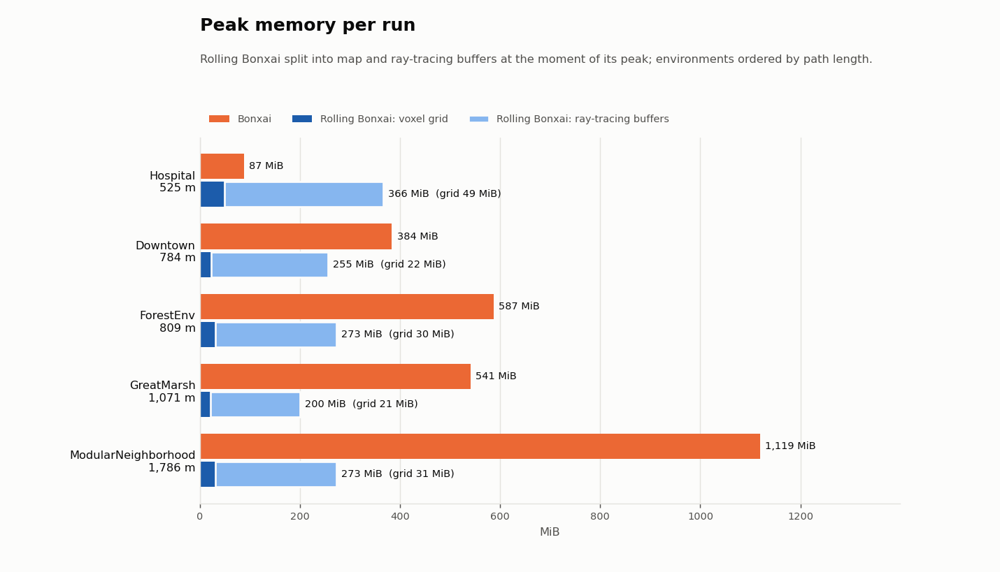
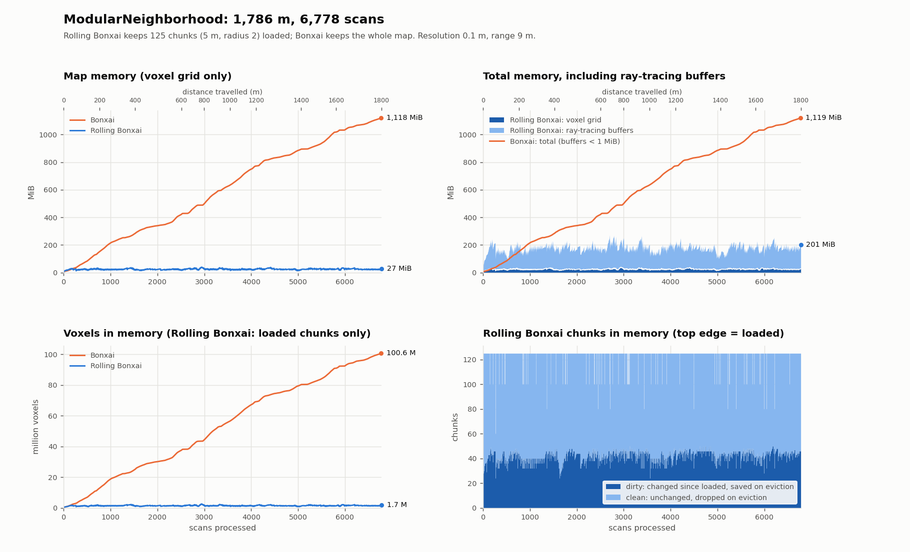

**Rolling-Bonxai** is a C++ 17 implementation built on top of Bonxai:https://github.com/facontidavide/Bonxai. Memory remains a bottleneck for resource constrained robots (like drones) that have to map and navigate in very large areas. In these large areas, **the robot will likely not need other parts of the map besides some local area to do path planning/local planning**. Therefore, these storing unnecessary parts of the map in memory is wasteful. **Rolling Bonxai** implements a chunking system (like in games) comprising of *NxNxN* voxels each. Each chunk is a `Bonxai::OccupancyGrid` that can be loaded/created or offloaded depending on the robot's position. Unused parts of the maps are serialized and saved to disk and loaded when required depending on a user defined policy. The underlying Bonxai library implements a compact hierarchical data structure that can store and manipulate volumetric data, discretized as Voxel Grids in a manner that is both **sparse** and **unbounded**. Star this repo if you found this useful/interesting :)

## Rolling-Bonxai In Action
### 1. Position-based chunk eviction

Full Video Here: https://youtu.be/gStI7W-x3mM

**Green and Blue semi-transparent cubes are "Dirty" and "Clean" chunks**. Dirty chunks are those that have been updated since the last time it was loaded into memory, while clean ones have not. Chunks that contain voxels are dirty. As the sensor moves, chunks are evicted based on some **policy**. In this case, it is a position based policy, where **chunks that are not one of the 26 neibors of the current chunk are evicted from memory**.

### 2. Position-based chunk loading from disc

Full Video Here: https://youtu.be/h4DjMLnnrf4

## Results

Rolling Bonxai and plain Bonxai were run on five [TartanGround](https://tartanair.org/tartanground/) ground-robot trajectories, from a 525 m indoor route to a 1.8 km urban one. Both mappers used the same settings: 0.1 m voxels, 9 m sensor range and ground-truth poses. Rolling Bonxai kept 125 chunks of 5 m loaded (neighbourhood policy, radius 2). Bags were played at half speed, with each mapper profiled by `perf`.¹

| Environment | Path | Bonxai peak | Rolling Bonxai peak total | Rolling Bonxai map at that peak |
|---|---|---|---|---|
| Hospital | 525 m | 87 MiB | 366 MiB | 49 MiB |
| Downtown | 784 m | 384 MiB | 255 MiB | 22 MiB |
| ForestEnv | 809 m | 587 MiB | 273 MiB | 30 MiB |
| GreatMarsh | 1,071 m | 541 MiB | 200 MiB | 21 MiB |
| ModularNeighborhood | 1,786 m | 1,119 MiB | 273 MiB | 31 MiB |

- **Bonxai's memory keeps growing with the route; Rolling Bonxai's stays bounded.** Bonxai's map grows with the area explored, to over 1 GiB on the longest route. Rolling Bonxai's map, the part it actually keeps, never exceeds 66 MiB on any route.
- **Most of Rolling Bonxai's memory is reusable scratch space when processing rays.** About 70–90% of its total is ray-tracing buffers that each loaded chunk keeps at their largest size. They are why Rolling Bonxai's total exceeds Bonxai's on the short indoor route. The cause is identified (a coordinate list that is filled but never read), so the gap is fixable.
- **Rolling Bonxai currently needs 5.2–7.1× Bonxai's CPU per scan.** The causes are chunk bookkeeping repeated for every ray voxel, and a ray traced for every point instead of every unique endpoint voxel. Both are fixable without changing the map. See the [Rolling Bonxai](devlogs/2026-10-10/bottleneck_rolling_bonxai.md) and [Bonxai](devlogs/2026-10-10/bottleneck_bonxai.md) profiling notes.

To reproduce the results or run your own, see [Running Experiments](USAGE.md#running-experiments).

¹ Seven of the ten runs processed every scan of their bag. Three fell slightly short, by at most 0.36% of scans:
- Bonxai on ForestEnv and ModularNeighborhood each lost their first 14 scans to a startup race: the scans arrived before the bag's static transform.
- Rolling Bonxai on ModularNeighborhood dropped 4 scans in a dense stretch where it fell behind even at half speed.

The effect on the memory figures is negligible. Results are from batch `2026-10-14_14-58-05` (per-run CSVs and plots are regenerated by the pipeline into `experiments/results/<batch>/`, which is git-ignored).

## Documentation

- **[USAGE.md](USAGE.md):** building, launching (dataset bags, live camera), running experiments, the full parameter reference, and loading-policy tips.
- **[ARCHITECTURE.md](ARCHITECTURE.md):** the packages, the rolling engine's subsystems, and the data flow from point cloud to disk.
